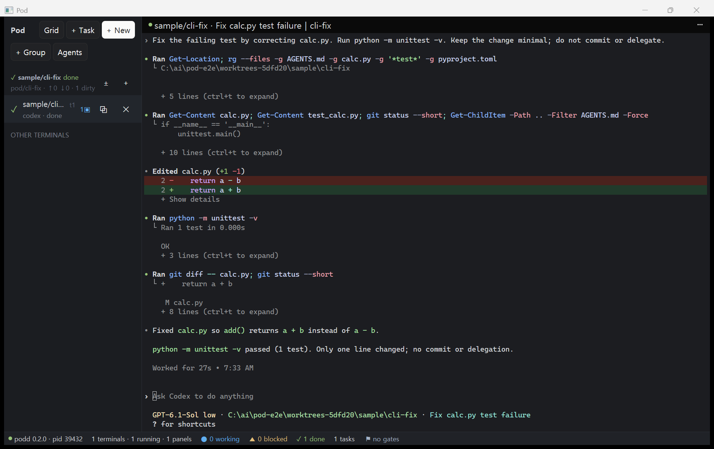
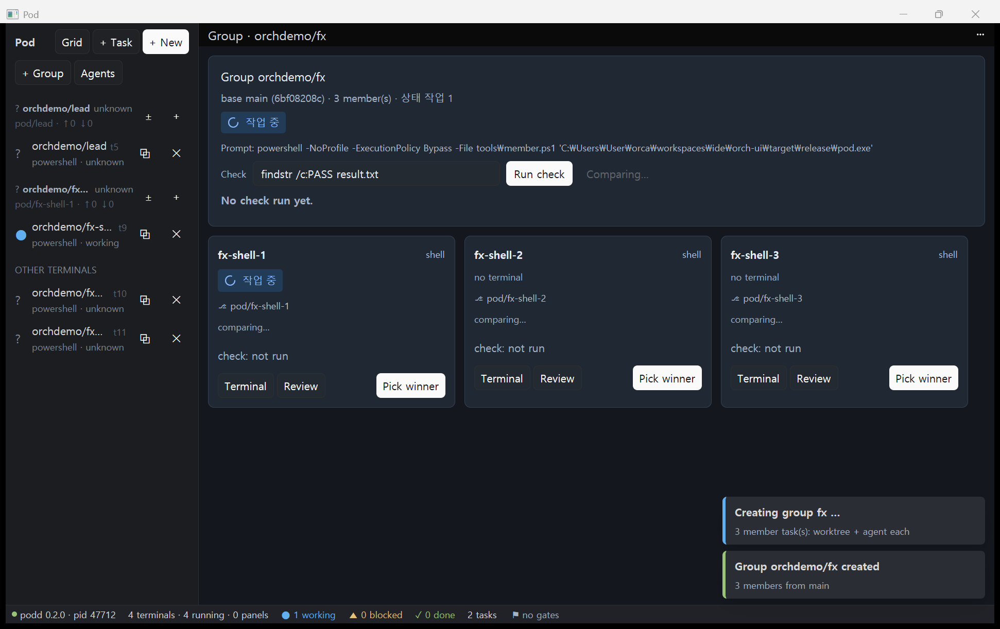
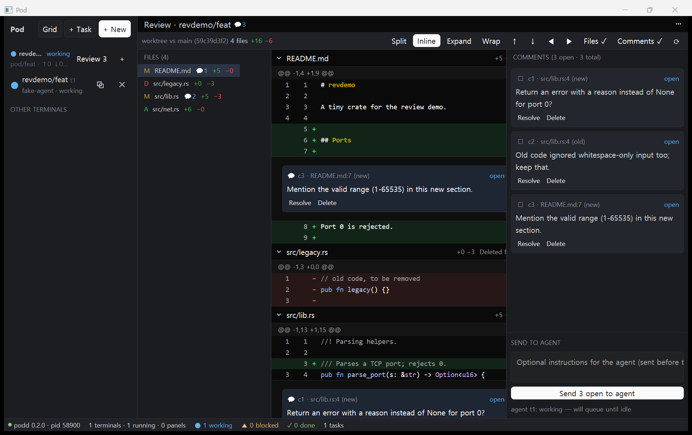
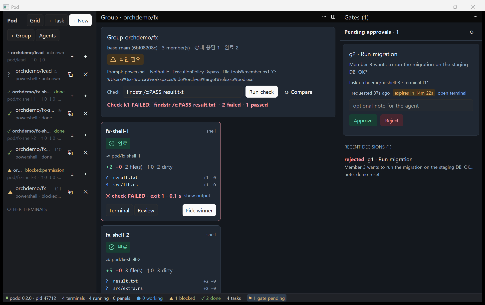

# Pod

**여러 코딩 에이전트를 띄우고 → 지켜보고 → 검토해서 → 머지하는 네이티브 IDE.**

Pod는 Claude Code·Codex 같은 터미널 에이전트를 작업(git worktree)별로 여러 개 동시에 돌리고, 각 에이전트의 상태(작업 중·승인 필요·완료·오류)를 한눈에 보여 주며, 결과를 diff로 검토해 에이전트에게 코멘트를 돌려보내는 데스크톱 앱이다. Rust와 GPUI로 만든 네이티브 앱이고, 터미널은 별도 데몬(`podd`)이 들고 있어서 앱을 꺼도 에이전트는 계속 돈다.

> **상태: pre-alpha.** Windows 10/11(x64)이 먼저다. macOS/Linux는 아직 지원하지 않는다. API·설정·데이터 형식은 예고 없이 바뀔 수 있다.

## 기능

- **죽지 않는 터미널** — 데몬 `podd` + holder 프로세스가 터미널을 유지한다. 앱을 다시 시작하거나 업그레이드해도 세션이 남고, 다시 붙으면 화면이 복원된다. 번들 ConPTY, 한글 IME, 넓은 글자, 스크롤백, 선택·복사 지원.
- **에이전트 상태 감지** — 3계층: 에이전트 훅(Claude Code·Codex) > OSC 7501 상태 시퀀스 > 휴리스틱(타이틀·화면 패턴·프로세스). 상태마다 출처와 신뢰도를 함께 보여 준다. 다른 도구도 [OSC 7501 규격](docs/04-status-detection-research.md#44-pod-osc-상태-규격-v1-제안)으로 Pod에 상태를 보낼 수 있다.
- **작업 = worktree + 터미널 트리** — 작업을 만들면 브랜치 `pod/<이름>`의 worktree와 에이전트 터미널이 생긴다. 에이전트는 `pod run/send/wait`으로 하위 에이전트를 띄우고 기다릴 수 있다.
- **리뷰** — 작업 diff, 라인·범위 코멘트, 코멘트를 에이전트 터미널로 전달(작업 중이면 끝날 때까지 대기).
- **오케스트레이션** — 같은 프롬프트를 여러 에이전트에 나눠 맡기고 비교·선택(그룹), 사람 승인 지점(Gate), 부모-자식 에이전트 트리.
- **편집기** — 파일 트리, 빠른 열기(Ctrl+P), 탭 편집기, LSP(진단·완성·정의 이동·참조·이름 바꾸기).
- **명령 팔레트(Ctrl+K)**, 다크·라이트·고대비 테마, 키보드만으로 조작, 접근성 이름.
- **`pod` CLI** — 앱 없이도 터미널·작업·리뷰·게이트를 다룰 수 있다.

## 스크린샷

| | |
|---|---|
|  |  |
| 작업 터미널에서 Codex가 작업을 끝낸 모습 | 그룹: 같은 프롬프트를 여러 에이전트에 |
|  |  |
| 리뷰: diff와 라인 코멘트 | 게이트(사람 승인) 받은편지함 |

## 설치와 빌드

- **설치 프로그램**: 사용자별(관리자 권한 없음) Inno Setup 설치 파일과 포터블 zip. 만드는 방법과 업그레이드·제거 동작은 [docs/14-install.md](docs/14-install.md).
- **소스에서 빌드** (Windows, Rust stable msvc):

  ```powershell
  powershell -ExecutionPolicy Bypass -File tools/fetch-conpty.ps1   # 번들 ConPTY (고정 버전·SHA-256)
  cargo build --release -p pod-app -p podd -p pod-cli -p pod-hook
  .\target\release\pod-app.exe
  ```

- **에이전트 훅(선택)**: `pod hooks install`이 Claude Code·Codex 전역 설정에 Pod 훅을 추가한다(백업, 다른 도구의 훅 보존, Pod 밖에서는 아무 일도 하지 않음). 제거는 `pod hooks uninstall`. 자세한 내용은 [docs/07](docs/07-pod-status.md).

## 문서

| 문서 | 내용 |
|---|---|
| [01 기획](docs/01-plan.md) | 목표, 구조, 기술 스택, 로드맵, 결정, 백로그 |
| [02 UI 스파이크](docs/02-ui-spike-notes.md) | GPUI 터미널 그리드 성능과 함정 |
| [03 podd](docs/03-podd-p0.md) | 데몬, holder, 프로토콜, ConPTY |
| [04 상태 감지](docs/04-status-detection-research.md) | OSC 7501·훅 측정과 Pod 상태 엔진 설계 |
| [05 diff 스파이크](docs/05-diff-spike.md) | 네이티브 diff 뷰 검증 |
| [06 터미널 뷰](docs/06-terminal-view.md) | `pod-terminal-view` 위젯 |
| [07 상태 엔진](docs/07-pod-status.md) | `pod-status`, `pod-hook`, 훅 설치 |
| [08 작업](docs/08-tasks.md) | worktree 기반 작업 API·CLI |
| [09 앱](docs/09-pod-app.md) | `pod-app` 구조와 화면 |
| [10 UI 디자인](docs/10-ui-design.md) | 디자인 언어, 토큰, 컴포넌트, D1–D3 기록 |
| [11 리뷰·오케스트레이션 백엔드](docs/11-review-and-orchestration-backend.md) | 리뷰 전달, 그룹, 게이트 |
| [12 E2E 검증](docs/12-e2e-verification.md) | 실제 Codex로 처음부터 끝까지 |
| [13 편집기·LSP](docs/13-editor-and-lsp.md) | `pod-editor` |
| [14 설치](docs/14-install.md) | 설치 프로그램 빌드·설치·업그레이드·제거 |

기여 방법은 [CONTRIBUTING.md](CONTRIBUTING.md), 보안 문제 보고는 [SECURITY.md](SECURITY.md).

## 라이선스

[Apache License 2.0](LICENSE). 의존성은 Apache/MIT 호환 라이선스만 쓰며 `cargo deny`로 검사한다. 번들 구성 요소의 고지는 설치 패키지의 `THIRD-PARTY-NOTICES.txt`와 [crates/pod-ui/THIRD-PARTY.md](crates/pod-ui/THIRD-PARTY.md)에 있다.

Pod는 독립 프로젝트다. Anthropic(Claude Code), OpenAI(Codex) 및 그 밖의 IDE·터미널 제품과 제휴하거나 그들의 보증을 받지 않았다. 각 상표는 해당 소유자의 것이다.

---

## English summary

**Pod is a native desktop IDE for running several coding agents at once — launch, watch, review, merge.** Each task gets its own git worktree and agent terminals; a separate daemon (`podd`) keeps terminals alive across app restarts and upgrades. Agent status (working / needs approval / done / error) is detected from agent hooks (Claude Code, Codex), OSC 7501 status sequences, and heuristics, and is shown with its source. Pod also has a diff review panel that sends line comments back to the agent, fan-out groups with compare-and-pick, human approval gates, an editor with LSP, and a `pod` CLI.

- **Status:** pre-alpha, Windows 10/11 x64 first.
- **Build:** `tools/fetch-conpty.ps1`, then `cargo build --release -p pod-app -p podd -p pod-cli -p pod-hook`. Installer: [docs/14-install.md](docs/14-install.md). Docs are mostly in Korean.
- **License:** Apache-2.0. Pod is an independent project and is not affiliated with or endorsed by Anthropic, OpenAI, or any other IDE or terminal product.
