# Windows 설치 프로그램: 빌드·설치·업그레이드·제거

작성일: 2026-11-09 · 코드: `tools/installer/` · 관련: [01 §7](01-plan.md)(Windows 먼저, Apache-2.0), [03](03-podd-p0.md)(podd·holder·번들 ConPTY), [07](07-pod-status.md)(훅), [09](09-pod-app.md)(앱이 podd를 찾는 방식, 설정 위치)

Pod를 매일 쓸 수 있게 **사용자별(관리자 권한 없음)** 설치 프로그램을 만든다. 결과물은 `dist\Pod-Setup-<버전>-x64.exe`(설치 프로그램)와 `dist\Pod-<버전>-x64-portable.zip`(포터블), `dist\SHA256SUMS.txt`이다. `dist/`는 git이 무시한다.

---

## 1. 결정: Inno Setup 6

| 후보 | 판단 |
|---|---|
| **Inno Setup 6.7.3** (채택) | 무료, 자체 허용 라이선스(상업 사용·재배포 허용, GPL 아님). `PrivilegesRequired=lowest`로 관리자 권한 없이 `%LOCALAPPDATA%\Programs`·HKCU에만 설치. 한국어 `Korean.isl` 기본 포함. Pascal 스크립트로 "실행 중인 데몬·터미널" 처리 가능. `winget install --id JRSoftware.InnoSetup -e --scope user`로 사용자 설치(이 PC에 설치함) |
| WiX 4/5 (MSI) | MS-RL 라이선스(빌드 도구라 문제는 없음). 사용자별 MSI는 가능하지만 실행 중 파일 처리·대화 상자를 커스텀 액션(DLL)으로 짜야 해서 비용이 큼 |
| MSIX | 서명이 필수(자체 서명은 사용자가 인증서를 신뢰해야 함), 패키지 컨테이너 안에서 분리 실행·전역 훅 경로(`%LOCALAPPDATA%\Pod\bin`)가 가상화됨 |

설치 프로그램 안에 들어가는 Inno 런타임(Setup.e32)도 같은 Inno 라이선스다. 패키지 안에 GPL 파일은 없다(§3).

## 2. 빌드

```powershell
powershell -ExecutionPolicy Bypass -File tools/installer/build.ps1            # 전체
powershell -ExecutionPolicy Bypass -File tools/installer/build.ps1 -SkipBuild # 이미 빌드했으면
```

필요한 것: Rust stable(msvc), `cargo-deny`, Inno Setup 6(없으면 스크립트가 설치 명령을 알려 줌, 또는 `ISCC` 환경 변수). 단계:

1. **버전**: 루트 `Cargo.toml`의 `[workspace.package] version`(지금 `0.1.0`). 크레이트도 `version.workspace = true`로 이 값을 쓴다(`pod --version`, `podd --version`, `server.status`의 version = 0.1.0). 예외: `pod-app`(0.1.0, 같은 값)과 `pod-terminal-view`(0.0.1)는 다른 작업이 고치는 중이라 그대로 두었다(둘 다 버전을 출력하지 않음, 다음에 맞출 것). 릴리스 때 이 값만 올린다.
2. **번들 ConPTY**: `vendor/conpty`가 없으면 `tools/fetch-conpty.ps1`(고정 버전·SHA-256).
3. **`cargo deny check`** (`-SkipDeny`로 생략). 
4. **`cargo build --release --locked -p pod-app -p podd -p pod-cli -p pod-hook`**. 각 cargo 실행 전 `tools/cpu-gate.ps1 -MaxPct 70 -MaxCargo 1`(공유 PC, `-NoCpuGate`로 생략).
5. **스테이지** `dist\stage\Pod-<버전>\`: 실행 파일 5개, `conpty.dll`, `x64\OpenConsole.exe`, `LICENSE.txt`, `README.txt`(한국어 안내, `tools/installer/README.txt`), `THIRD-PARTY-NOTICES.txt`, `licenses\ConPTY-LICENSE.txt`, `licenses\Lucide-LICENSE.txt`. `.pdb`는 넣지 않는다.
6. **고지문** `tools/installer/notices.ps1`: `cargo metadata --locked --filter-platform x86_64-pc-windows-msvc`에서 배포 크레이트 4개의 **일반(normal) 의존성만** 따라간다(빌드·개발 의존성은 배포 파일에 없음). 크레이트마다 이름·버전·SPDX·저장소를 표로, 패키지 안의 `LICENSE*`/`COPYING*`/`NOTICE*`/`COPYRIGHT*`/`UNLICENSE*`/`license-file` 원문을 싣는다(같은 원문은 한 번만, 쓰는 크레이트 목록과 함께). 라이선스 파일이 없는 크레이트(28개, 예: accesskit, lyon, tree-sitter 문법)는 SPDX에 맞는 표준 문구(MIT는 authors로 저작권 줄)를 넣는다. GPL 계열(`OR`로 다른 선택지가 없는 GPL/LGPL/AGPL)이나 라이선스 없는 크레이트가 있으면 **빌드 실패**. 지금: 469개 크레이트, 원문 275종, 약 0.9 MB.
7. **ISCC** `tools/installer/pod.iss` (`/DAppVersion /DStageDir /DOutputDir`). `pod.iss`는 한국어 문자열 때문에 **UTF-8 BOM**을 유지해야 한다.
8. **포터블 zip**(안에 `Pod-<버전>\` 폴더), **SHA-256** → `dist\SHA256SUMS.txt`.

## 3. 패키지 내용과 라이선스

| 파일 | 출처 | 라이선스 |
|---|---|---|
| `pod-app.exe`, `podd.exe`, `pod-holder.exe`, `pod.exe`, `pod-hook.exe` | 이 저장소 | Apache-2.0 (+ 고지문의 크레이트들) |
| `conpty.dll`, `x64\OpenConsole.exe` | NuGet `Microsoft.Windows.Console.ConPTY` 1.25.260930003 | MIT. 패키지에 라이선스 파일이 없어 `microsoft/terminal`의 LICENSE 원문을 `tools/installer/licenses/ConPTY-LICENSE.txt`에 둠 |
| Lucide 아이콘(pod-app 안에 내장) | `crates/pod-ui/THIRD-PARTY.md` | ISC(+Feather MIT) |

배포 크레이트의 라이선스 분포: MIT/Apache 이중 ~290, MIT 85, Apache-2.0 22, Unicode-3.0 22, BSD 2/3 12, Zlib, ISC, 0BSD, BSL-1.0, CC0, Unlicense(OR MIT) 등. **약한 카피레프트 1개**: `option-ext` 0.2.0(MPL-2.0, `dirs-sys` 경유) — deny.toml의 검토된 예외이고 수정 없이 쓴다. MPL은 파일 단위라 Apache 작업물과 함께 배포할 수 있다(고지문에 원문·소스 주소 포함). 루트에 `LICENSE`(Apache-2.0 원문)를 새로 두었다(이전에는 Cargo.toml 선언만 있었음).

## 4. 설치

- 위치: **`%LOCALAPPDATA%\Programs\Pod`** (`{userpf}\Pod`). 처음 설치 때만 폴더 페이지가 나오고, 업그레이드는 이전 위치를 쓴다.
- 시작 메뉴 **"Pod"**(`…\Start Menu\Programs\Pod.lnk` → `pod-app.exe`, 작업 폴더 `%USERPROFILE%`). 바탕 화면 바로 가기는 선택(기본 끔).
- **PATH**(선택, 기본 켬): `HKCU\Environment\Path`에 설치 폴더를 더한다(사용자 값만, 기존 값의 끝 `;` 형식 유지, 제거·선택 해제 때 정확히 원래 값으로 되돌림, `WM_SETTINGCHANGE` 알림). 설치 폴더 전체가 PATH에 들어가므로 `podd`/`pod-app`도 이름으로 실행된다.
- 제거 정보: `HKCU\Software\Microsoft\Windows\CurrentVersion\Uninstall\{8C7541A9-1FDB-43FC-B2EB-44131622A0CF}_is1` ("설정 > 앱"에 Pod 0.1.0으로 보임). HKLM·Program Files는 건드리지 않는다.
- 마지막 페이지: **"Pod 실행"**(기본 켬). 훅 항목은 §6.
- 조용한 설치: `Pod-Setup-0.1.0-x64.exe /VERYSILENT /SUPPRESSMSGBOXES [/DIR="…"] [/TASKS="addtopath,desktopicon"]`. `/CURRENTUSER`도 받는다(이미 사용자 설치라 의미 없음). 조용한 모드에서는 모든 질문이 기본값으로 답해진다(앱 닫기·데몬 멈추기 = 예, 훅 설치 = 하지 않음).
- 설치 로그: `/LOG="파일"`. `[Code]`의 판단(프로세스 탐지, `pod …` 실행 결과, 옮긴 파일)은 모두 로그에 남는다.

## 5. 업그레이드 (터미널을 끄지 않는다)

새 설치 프로그램을 그냥 실행한다. "준비 중" 단계(`PrepareToInstall`)에서 **이 설치 폴더에서 실행 중인** 프로세스만 본다(WMI `Win32_Process.ExecutablePath`가 설치 폴더 아래인 것. 다른 체크아웃의 개발용 podd·다른 파이프는 건드리지 않음):

1. **pod-app**: "앱을 닫고 계속할까요? 터미널과 에이전트는 꺼지지 않습니다" → 예: `WM_CLOSE`(taskkill), 5초 뒤에도 남으면 강제 종료. 앱은 상태가 없으므로 안전하다(09 §1). 아니요: 설치 중단.
   Restart Manager(`CloseApplications`)는 **끈다**. 켜 두면 사용 중인 `pod-holder.exe`/`OpenConsole.exe`를 "닫을 프로그램"으로 제안해 사용자의 에이전트 터미널을 죽일 수 있다.
2. **podd**: "데몬을 멈추고 계속할까요? 실행 중인 터미널 N개와 에이전트는 계속 돕니다" → 예: 이전 버전의 `pod.exe server stop`(holder는 남음, 03 §2), 8초 안에 안 끝나면 강제 종료(이것도 안전: holder가 살아 있고 새 데몬이 다시 붙음, 03 §6 테스트 2).
3. **holder(터미널)**: 끄지 않는다. 안내만 한다(조용한 모드에서는 생략). Windows는 실행 중인 exe·로드된 DLL을 **덮어쓰거나 지울 수 없지만 이름은 바꿀 수 있다**. 그래서 `[Files]`의 `BeforeInstall: MoveAsideIfLocked`가 파일마다: 지울 수 있으면 지우고, 잠겨 있으면 `<이름>.old-<yyyymmddhhnnss>`로 옮긴 뒤 새 파일을 쓴다. 실제로 옮겨지는 것: `pod-holder.exe`, `conpty.dll`(holder가 로드), `x64\OpenConsole.exe`(터미널마다 실행), 드물게 `pod.exe`(`pod attach` 중).
   - 남은 터미널은 닫을 때까지 **이전 holder 바이너리**로 돈다. 새 podd는 holder 프로토콜 버전 협상(03 §3, `HOLDER_PROTOCOL_MIN..=HOLDER_PROTOCOL`)으로 붙는다. 새 터미널은 새 `pod-holder.exe`로 뜬다.
   - `.old-*` 파일은 설치 마지막(`ssPostInstall`)과 다음 설치·제거 때 지운다(아직 쓰이면 남김, 로그에 "still in use").
   - 버전별 holder 경로(`holder\<버전>\pod-holder.exe`) 대신 이 방식을 고른 이유: podd가 holder를 "자기 옆의 `pod-holder.exe`"로 찾고(`ServerConfig::new`, `POD_HOLDER`), ConPTY도 "holder 옆의 `conpty.dll`"로 찾는다(`pty::conpty_api`). 이름 바꾸기는 코드 변경 없이 같은 효과(실행 중 파일과 새 파일 공존)를 낸다.
   - 한계: holder 프로토콜이 지원 범위 밖으로 바뀌는 업그레이드면 이전 터미널은 `incompatible_holder`로 보인다(03 §3: 입력 불가, `rm --force`로 정리). 지금은 범위 안.
4. 설치가 끝나면 앱은 다시 열 때(마지막 페이지 "Pod 실행") 새 `podd.exe`를 자동 시작하고, 새 데몬이 상태 디렉터리의 holder 기록으로 터미널을 다시 찾는다.

업그레이드 도중 Pod 터미널 안의 에이전트가 `pod …`를 실행하면 데몬이 자동 시작될 수 있다(그 순간 설치 폴더의 `podd.exe`가 이전/새 파일 중 무엇이든). 문제가 생기면 `pod server stop` 후 다시 시작하면 된다(holder는 영향 없음).

## 6. 에이전트 훅

훅 설치는 사용자 에이전트 설정(`~/.claude/settings.json`, `~/.codex/hooks.json`, Codex 신뢰 항목)을 고치므로 **설치 프로그램이 스스로 하지 않는다**.

- 설치·업그레이드 끝(`ssPostInstall`)에 `{app}\pod.exe hooks status`를 실행한다(읽기만). 출력에 `differs from this build`(설치된 `%LOCALAPPDATA%\Pod\bin\pod-hook.exe`가 이 패키지의 것과 다름), `missing`(파일 없음·훅이 가리키는 exe 없음), ` 0 Pod event`(훅 없음)가 있으면 마지막 페이지에 **체크 해제된** "에이전트 상태 훅 설치·업데이트" 항목과, 그 위에 이유와 `pod hooks install`이 하는 일을 보인다. 고르면 콘솔 창에서 `pod hooks install`을 실행하고 결과를 보여 준다(`pause`). 조용한 설치에서는 절대 실행하지 않는다(`skipifsilent` + 기본 해제).
- 훅은 언제나 `%LOCALAPPDATA%\Pod\bin\pod-hook.exe`를 가리킨다(07 §9). 설치 폴더의 `pod-hook.exe`는 그 원본일 뿐이라 업그레이드가 실행 중인 훅을 깨지 않는다. 새 pod-hook을 쓰려면 `pod hooks install`을 다시 실행한다.
- 제거 때: `pod hooks status`에 Pod 훅(`runs …`)이 있으면 "훅도 제거할까요?"(기본 **아니요**, 조용한 모드 아니요). 예 → `pod hooks uninstall`(백업 후 Pod 항목만 제거, pod-cli에 이미 있음) 성공 시 `%LOCALAPPDATA%\pod\bin`도 지운다. 아니요 → 훅과 `pod-hook.exe`가 남고, Pod 밖에서는 아무 일도 하지 않는다.

## 7. 제거

"설정 > 앱 > Pod" 또는 `{app}\unins000.exe`.

1. **실행 중인 터미널**이 있으면(이 설치 폴더의 `pod-holder.exe`): "터미널 N개를 모두 종료하고 제거할까요?"(기본 **아니요** = 제거 취소). 조용한 제거는 터미널이 있으면 **취소**한다(종료 코드 1, 에이전트를 묻지 않고 죽이지 않음). `/STOPTERMINALS`를 주면 예로 처리한다. 예 → `pod server stop --kill`(데몬이 없으면 `pod ls`로 띄워 holder를 다시 찾은 뒤), 10초 뒤 남은 holder는 강제 종료(Job Object가 자식 트리 정리), 남은 `OpenConsole.exe` 정리.
2. pod-app 닫기, podd 멈추기(업그레이드와 같은 방식).
3. PATH 항목 제거, 훅 질문(§6), 파일·바로 가기·제거 정보 삭제, `.old-*` 정리.
4. **사용자 데이터**: "Pod 사용자 데이터도 지울까요?"(기본 **아니요** = 남김, 다시 설치하면 이어서 씀). `/PURGEDATA`는 예. 지우는 것: `%LOCALAPPDATA%\pod\state`, `%LOCALAPPDATA%\pod\podd.log`, `%APPDATA%\pod`(앱 설정·레이아웃). 빈 `%LOCALAPPDATA%\pod`는 지운다. **지우지 않는 것**: Task worktree(`%USERPROFILE%\pod\worktrees`, 사용자 코드), 프로필 스코프 에이전트 설정(`%LOCALAPPDATA%\pod\profiles`, 로그인 정보가 있을 수 있음), 훅을 남기기로 한 경우의 `pod\bin`.
   데이터 경로는 Pod와 똑같이 **환경 변수** `LOCALAPPDATA`/`APPDATA`로 계산한다(테스트가 이를 임시 폴더로 바꿔 실제 데이터를 건드리지 않음).

조용한 제거 예: `unins000.exe /VERYSILENT /SUPPRESSMSGBOXES /STOPTERMINALS [/PURGEDATA]`. Inno 6.7 제거기는 `%TEMP%`의 `_unins.tmp`로 다시 실행되므로 `/LOG=` 경로는 절대 경로를 쓴다.

## 8. 포터블 zip

`Pod-<버전>-x64-portable.zip`을 풀고 `pod-app.exe`를 실행한다. 설치 프로그램과 같은 파일이다. 시작 메뉴·PATH·제거 정보가 없고, 데이터 위치는 같다. 업그레이드는 폴더를 바꾸는 것이라 실행 중인 holder가 있으면 이전 폴더를 지울 수 없다(터미널을 닫은 뒤 지울 것).

## 9. 서명과 SmartScreen

코드 서명은 하지 않았다(범위 밖). 그래서 내려받은 설치 프로그램을 처음 실행하면 **Windows SmartScreen**이 "Windows의 PC 보호" 경고를 띄울 수 있다 → "추가 정보" → "실행". 받은 파일은 `SHA256SUMS.txt`와 비교한다. 정식 배포 전에는 Authenticode 서명(EV 또는 Azure Trusted Signing)으로 `Pod-Setup-*.exe`와 exe 5개를 서명해야 경고가 사라진다(평판이 쌓이기 전에는 OV 서명도 경고가 남을 수 있음). 번들 `conpty.dll`/`OpenConsole.exe`는 Microsoft 서명이 이미 있다.

## 10. 테스트 (2026-11-09)

### 10.1 설치·업그레이드·제거 자동 테스트 — `tools/installer/test-install.ps1`

격리: 설치 폴더 `%TEMP%\pod-install-test\app`(`/DIR`), 데몬 파이프 `POD_SOCKET=podd-installer-test`, `LOCALAPPDATA`/`APPDATA`/`POD_WORKTREES_ROOT`를 임시 폴더로. 진짜인 것(끝나고 원래대로인지 검사): 시작 메뉴 바로 가기, HKCU 제거 정보, PATH. 실패해도 마지막에 정리한다(제거기 → 남은 프로세스 종료 → 키·바로 가기 삭제 → PATH 복원). 실제 전역 훅 파일(`~/.claude/settings.json`, `~/.codex/hooks.json`, `config.toml`, `%LOCALAPPDATA%\Pod\bin\pod-hook.exe`)은 테스트 전후 SHA-256이 같았다.

결과: **53개 통과, 실패 0** — 깨끗한 클론에서 `build.ps1`로 만든 설치 프로그램(SHA-256 `4006b0cb…58adb`)으로 실행. 버전 통일·문구 수정 뒤 다시 빌드한 설치 프로그램(`34f5db6f…5c3d`)으로도 53/53. 기록: [install/test-log.md](install/test-log.md) (설치·제거 로그는 `dist\test-*\`)

| 단계 | 확인한 것 |
|---|---|
| 1. 새 설치 `/VERYSILENT /TASKS=addtopath` | 종료 코드 0, 파일 12개, 시작 메뉴 바로 가기와 대상, 바탕 화면 없음, 제거 정보(Pod 0.1.0, 위치), PATH에 추가, 훅은 상태만 확인하고 설치 안 함 |
| 2. 설치된 바이너리 | `pod --version`, `podd --version`, `pod hooks status`, `pod-app --ui-fixture` 창이 **서브 모니터**에 뜸(캡처 `docs/install/16-installed-app-fixture.png`), `pod run`이 설치 폴더의 podd·holder로 터미널 시작, 터미널 ConPTY = `bundled:<설치 폴더>\conpty.dll` |
| 3. 같은 설치 프로그램으로 업그레이드(podd + 터미널 1개 실행 중) | 종료 코드 0, `pod server stop` 정상, **holder 같은 pid로 생존**, `pod-holder.exe`/`conpty.dll`/`OpenConsole.exe`가 `.old-*`로 옮겨지고 새 파일 배치, 새 podd가 터미널을 다시 찾아 `running`, 화면 출력 유지 |
| 4. 터미널 실행 중 조용한 제거 | 제거 거부(종료 코드 1), 설치·터미널 그대로 |
| 5. `/STOPTERMINALS` 제거(데이터 유지) | 종료 코드 0, 프로세스 0, 설치 폴더(`.old-*` 포함)·바로 가기·제거 정보 삭제, PATH 원래 값, 상태 디렉터리 남음 |
| 6. PATH 없이 재설치 → `/PURGEDATA` 제거 | PATH 변화 없음, state·로그·앱 설정 삭제, 시작 메뉴·제거 정보·PATH·바탕 화면 모두 테스트 전과 같음 |

### 10.2 한국어 화면 — `tools/installer/capture-pages.ps1`

같은 격리로 대화형 설치 → 터미널 시작 → 대화형 업그레이드 → 대화형 제거를 UI Automation으로 진행했다. 실제 마우스·키보드는 쓰지 않는다(Inno 6.7 버튼은 UIA Invoke가 없는 `TNewButton` 창이라 그 창에 `BM_CLICK`을 보냄). 모든 창은 서브 모니터로 옮긴다. 서브 모니터가 150%라 시스템 DPI 인식 창은 DWM이 늘려 그리므로, PrintWindow 결과를 모니터/창 DPI 비로 잘라 저장한다. 캡처 방식 주의: `PrintWindow(PW_RENDERFULLCONTENT=2)`는 DWM 표면을 복사하는데, 세션이 잠긴 동안 이 표면이 늦게 갱신되어 체크 목록 항목·준비 페이지 메모·라벨 속 라틴 문자(`pod`, `PATH`, 괄호)가 빠진 캡처가 나왔다(첫 커밋의 `03-tasks.png`). 문자열 자체는 정상이었다(같은 문구의 다른 캡처는 온전함). 그래서 테두리는 플래그 2로, 클라이언트 영역은 창이 우리 DC에 직접 그리는 플래그 0으로 찍어 합친다(세 번 찍어 같은 결과). 훅 질문은 "아니요", 데이터 질문은 "예"(임시 폴더 데이터만). 끝에 프로세스 0, 설치 폴더·데이터·제거 정보 없음, PATH 원래 값 확인.

| | |
|---|---|
| 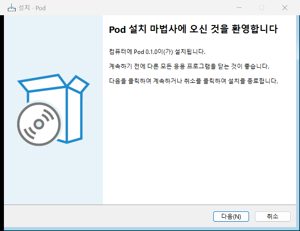 시작 | 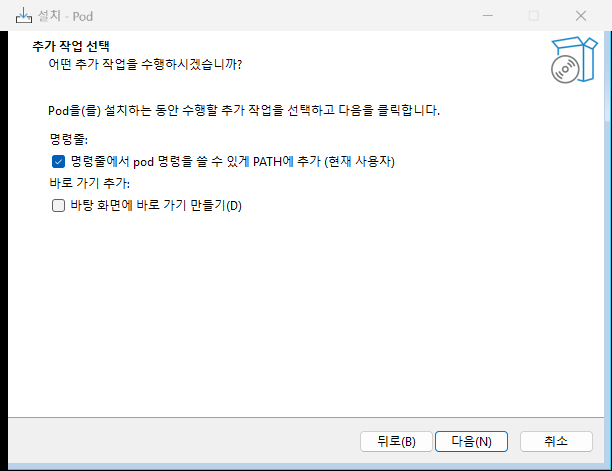 추가 작업(PATH, 바탕 화면) |
| 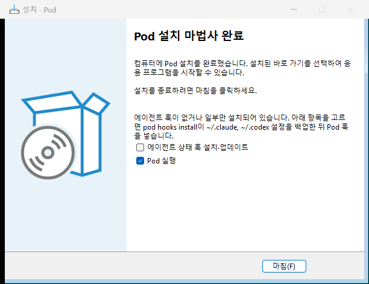 완료: 훅이 없거나 다르면 이유 + 해제된 훅 항목, "Pod 실행" | 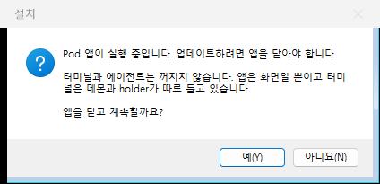 업그레이드: 앱 닫기 |
| 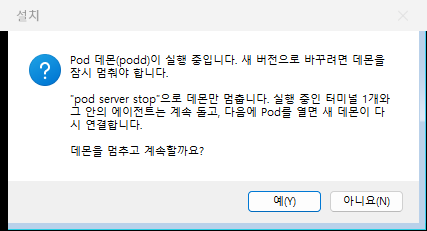 업그레이드: 데몬만 멈춤 | 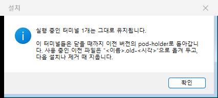 업그레이드: 터미널 유지 안내 |
| 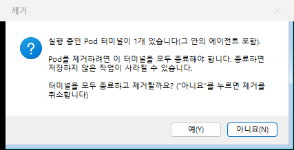 제거: 실행 중 터미널 | 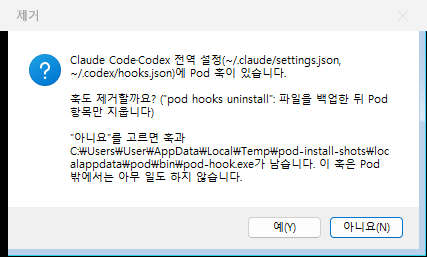 제거: 훅 제거 여부(기본 아니요) |
| 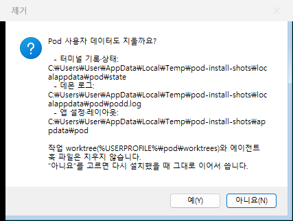 제거: 사용자 데이터(기본 아니요) | 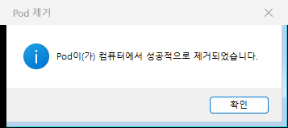 제거 완료 |

나머지: `02-dir`, `04-ready`, `06-upgrade-welcome`, `10-upgrade-finished`, `11-uninstall-confirm`. 설치된 앱: `16-installed-app-fixture.png`. 메시지 상자의 `₩`는 한국어 글꼴에서 `\`가 그렇게 보이는 것이다.

## 11. 후속 작업

1. **코드 서명**(§9): 인증서 결정 필요(사용자 결정).
2. Application icon: implemented; see section 12 and `assets/icon/qa/`.
3. Executable VERSIONINFO: implemented for all five shipped binaries (section 12).
4. ~~`pod --version`이 0.2.0~~ 고침: 크레이트가 `workspace.package.version`을 쓴다. `pod-app`·`pod-terminal-view`·`pod-editor`도 이미 `version.workspace = true`(fu-app에서 확인).
5. ~~앱 안 첫 실행 안내~~ → fu-app([docs/09 §12.2](09-pod-app.md#122-훅-설치-안내-docs14-115)): 시작할 때 `pod hooks status --json`으로 확인하고, 훅이 없거나 다른/이전 pod-hook이면 비차단 배너 `훅 설치`(dry-run으로 바뀔 파일·백업을 보여 주고 확인해야 설치) / `나중에`(앱 버전 + pod-hook 빌드별로 기억). 제거(`pod hooks uninstall`)는 앱에 없다(설치 프로그램만).
6. winget 매니페스트·자동 업데이트, ARM64 패키지(`fetch-conpty.ps1 -Arch arm64`는 이미 있음).
7. 업그레이드 중 에이전트가 `pod`로 데몬을 자동 시작하는 경쟁(§5 끝): 필요하면 설치 중 표식 파일을 두고 클라이언트가 잠시 기다리게.
8. 라이선스 파일이 패키지에 없는 크레이트 28개: 표준 문구로 대신했다. 정식 배포 전 상위 저장소의 LICENSE 원문으로 바꿀지 검토.


## 12. Application identity and Windows resources

`assets/icon/pod.ico` supplies SetupIconFile, each executable's group-icon resource
(ID 1), the Start menu/desktop shortcuts (explicit exe icon index 0), and
UninstallDisplayIcon. Product name is Pod; publisher/author is SJin-Choi.
`assets/windows/resources.rs`, included by each package build.rs, creates per-binary
VERSIONINFO from the inherited workspace package version. File descriptions name
the IDE, daemon, terminal host, CLI and hook relay and identify Apache-2.0.
The MIT build-only dependency `embed-resource` links each resource only to its
named executable, so podd's client library cannot inject duplicate resources.
Existing subsystem and manifest/DPI behavior is preserved. GPUI's native HWND
receives both class and window icons at startup using its monitor DPI.

Icon source, optical sizes and concepts: [identity README](../assets/icon/README.md).


Validation of this identity update (2026-11-09): release build succeeded;
`cargo test --workspace --locked` ran once with **339 passed, 0 failed, 2 ignored**;
Clippy for pod-app/podd/pod-cli/pod-hook with `--all-targets -- -D warnings`
succeeded. `cargo deny check` ended with:

```text
advisories ok, bans ok, licenses ok, sources ok
```

The rebuilt installer passed **63/63** checks (the previous 53 plus shortcut icon,
all five VERSIONINFO records, uninstall icon, and three native window/class icon
checks). Install, upgrade with a live terminal, uninstall refusal, full uninstall,
and purge all passed; PATH, shortcuts, processes and uninstall registration were
restored/removed. Test cleanup now runs in `finally`, and recursive deletion is
restricted to the temporary prefix. `POD_CPU_GATE` can select the shared machine's
current gate script; the default remains the checkout's `tools/cpu-gate.ps1`.

Evidence: [installer test log](../assets/icon/qa/install-test/test-log.md),
[workspace test log](../assets/icon/qa/workspace-tests.txt),
[Clippy](../assets/icon/qa/clippy.txt), [cargo-deny](../assets/icon/qa/cargo-deny.txt),
[resource verification](../assets/icon/qa/embedded-icons.txt).

Installer SHA-256: `6c7178c64f7d7cb331e8c90fa91d6a055f4a8b2639f8fda55cce179c596b977f`.


Native screenshots and monitor/DPI provenance: [full icon QA](../assets/icon/qa/report.md).
The app and installer windows use the secondary monitor. This Windows session has
no secondary taskbar, so taskbar evidence captures the existing primary bar;
no taskbar setting was changed. New installer artwork:

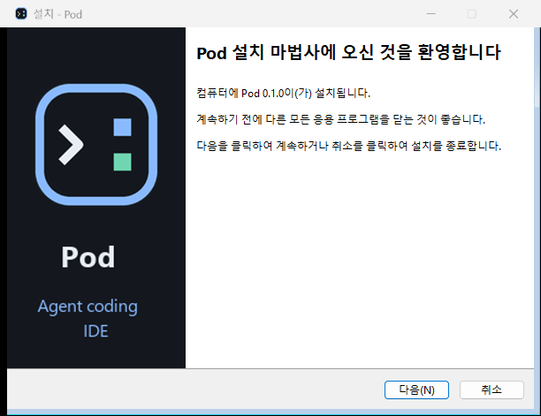
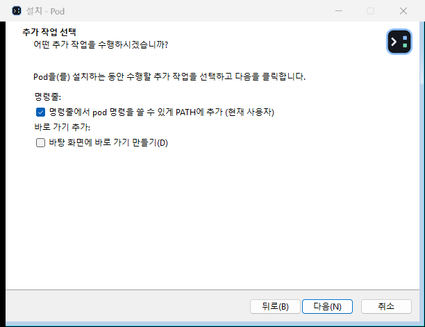
